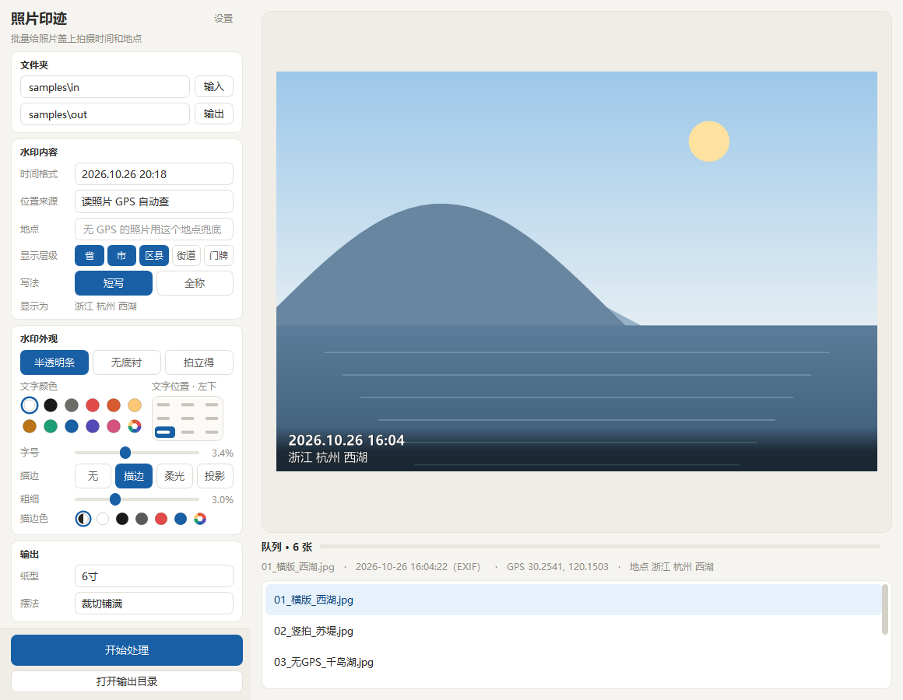
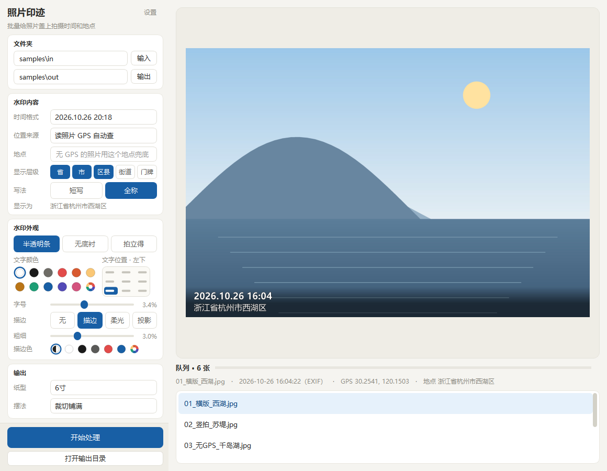
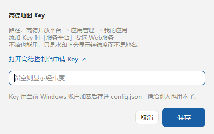

# 照片印迹 · Photo Imprint

给照片盖上**拍摄时间**和**拍摄地点**的水印，批量输出成能直接送打印店冲印的尺寸。

Windows 桌面程序，纯本地运行（除逆地理编码会请求高德），不修改原图。



---

## 为什么做这个

旅行回来一堆照片，想冲印出来做相册，但照片本身不写时间和地点——过两年就说不清是哪一天、在哪儿拍的了。
用手机 App 加水印要一张张来，而打印店只收统一尺寸的文件。这个工具就是解决这两件事：

- **一张不漏**：整个文件夹批量处理，按拍摄时间排好序输出
- **尺寸统一**：选 6 寸就输出 1800×1200，补白不裁切，水印不会被冲印裁掉
- **信息齐全**：时间来自 EXIF，地点来自 GPS（自动查地址）或手动指定

## 功能

- **三种水印样式**：底部半透明条 / 左下角无底衬 / 拍立得白边
- **九宫格位置**：左上到右下九个位置随便放，界面上是 3×3 小示意图
- **时间格式自由**：7 种预设 + 自定义 `strftime`，也可以只显示日期、只显示时间、或者不显示
- **地名层级自选**：省 / 市 / 区县 / 街道 / 门牌 五档勾哪档显示哪档，并可切换两种写法

  | 勾选 | 短写 | 全称 |
  |---|---|---|
  | 省 + 市 | 甘肃 白银 | 甘肃省白银市 |
  | 省 + 区县 | 甘肃 会宁 | 甘肃省会宁县 |
  | 省 + 市 + 区县 | 浙江 杭州 西湖 | 浙江省杭州市西湖区 |
  | 全勾 | 浙江 杭州 西湖 西湖街道 北山街14号 | 浙江省杭州市西湖区西湖街道北山街14号 |

- **描边四态可调**：无 / 描边 / 柔光 / 投影，粗细与颜色都能单独调（默认自动反色）
- **纸型与摆法**：6 寸 / 7 寸等预设，补白不裁切或裁切铺满
- **全中文界面**：连取色器、文件对话框这类 Qt 内置控件也是中文
- **Key 加密存储**：高德 Key 用 Windows DPAPI 加密后落盘，拷给别人也用不了

## 下载 & 运行

### 方式一：直接用打包版（推荐）

到 [Releases](../../releases) 下载 `照片印迹.exe`，双击即用。单文件，不需要装 Python。

- 系统要求：Windows 10 / 11
- 首次运行会在 exe 旁边生成 `config.json`（保存你的偏好设置）

### 方式二：从源码跑

```bash
git clone https://github.com/lp2924/photo-imprint.git
cd photo-imprint
python -m venv .venv
.venv\Scripts\pip install -r requirements.txt

.venv\Scripts\python.exe app.py            # 界面模式
```

## 快速上手

1. **输入 / 输出**：选原图文件夹，输出目录默认是它下面的 `out`
2. **调水印**：样式、位置、颜色、字号、描边，右侧实时预览
3. **开始处理**：输出文件名形如 `2026-10-26_1604_浙江杭州西湖.jpg`，按时间排序就是打印顺序

地名两种写法的对比（同一张照片，只换了「写法」）：



## 地点从哪来

- **读照片 GPS 自动查地址**（默认）：从 EXIF 取经纬度，WGS-84 转 GCJ-02 后调高德逆地理编码
- **手动指定地点**：整批统一用一个地名，也用作没有 GPS 那几张的兜底

不填高德 Key 也能跑，只是水印上显示经纬度而不是地名。

### 申请高德 Key

1. 打开 [高德开放平台控制台](https://console.amap.com/dev/key/app)，注册/登录
2. 「应用管理 → 我的应用 → 创建新应用」，类型随便填
3. 添加 Key，**服务平台选「Web服务」**（不是「Web端(JS API)」）
4. 复制 Key，粘到程序的「设置」里

程序「设置」弹窗里也有直达链接（「打开高德控制台申请 Key ↗」），点一下就用默认浏览器打开上面那个页面。



## 命令行

```bash
照片印迹.exe --cli -i 原图目录 -o 输出目录 [参数]
```

| 参数 | 说明 |
|---|---|
| `--style B\|A\|C` | 水印样式，默认 B |
| `--position bottom-left` | 九宫格位置：`top/middle/bottom` + `left/center/right` |
| `--outline solid` | 描边样式：`none` / `solid` / `glow` / `shadow` |
| `--outline-color auto` | 描边颜色，`auto`=跟随文字反色，或 `#RRGGBB` |
| `--outline-width 3.0` | 描边粗细，占字号百分比（0.8~8.0） |
| `--color "#E24B4A"` | 文字颜色，不填按样式自动（拍立得深灰，其余白色） |
| `--date-format "%Y年%m月%d日"` | 时间格式，传 `""` 则不显示时间 |
| `--place-slots province,district` | 地名层级：`province/city/district/township/road` 任选 |
| `--place-detail city\|district\|street\|full` | 层级预设，`--place-slots` 优先 |
| `--place-style short\|full` | 地名写法，默认短写 |
| `--paper 6寸` `--fill` | 纸型 / 是否裁切铺满 |
| `--key xxxxx` | 高德 Key，默认读环境变量 `PHOTOIMPRINT_AMAP_KEY` 或 `config.json` |
| `--workers 4` `--quality 95` | 并发线程数 / JPEG 质量 |

## 三种水印样式

| 样式 | 说明 | 适用 |
|---|---|---|
| **B 底部半透明条** | 底部渐变条 + 文字 | 默认。任何底色都能读清，打印最稳 |
| **A 左下角无底衬** | 纯文字 + 极淡描边 | 最像相机原生水印，画面干净 |
| **C 拍立得白边** | 四周白边，文字写在下方白边 | 文字对比度最高，白边天然留裁切余量 |

支持 jpg / jpeg / png / heic / heif / webp / tif，iPhone 的 HEIC 由 `pillow-heif` 解码。

## 隐私

- **原图只读**，不会被修改
- 开了 GPS 自动查地址时，**坐标会发到高德服务器**；不想联网就用手动指定地点
- 地址结果按约 500 米网格缓存在 `geo_cache.json`，同一景点只查一次
- `config.json` / `geo_cache.json` 都在 `.gitignore` 里，不会被提交

### Key 怎么存

- 配置里只有 `api_key_enc`——用 Windows DPAPI 加密的密文，**只有当前 Windows 账户能解开**
- 整个目录连 `config.json` 拷给别人，对方也解不开你的 Key（DPAPI 的预期行为）
- 临时用一次不想落盘：设环境变量 `PHOTOIMPRINT_AMAP_KEY`，优先级高于配置文件
- 换电脑 / 重装系统 / 换 Windows 账户后密文失效，在「设置」里重填一次即可

> DPAPI 只挡「拷走配置文件」，挡不住「在你机器上跑起来后从内存里读」。要分发给别人，最省事的做法就是让对方填自己的 Key（程序本来就是这么设计的）；要彻底隐藏就自建云函数代理，Key 只留在服务端。

## 项目结构

```
photo-imprint/
├─ app.py               入口：界面 / 命令行
├─ core/
│  ├─ exif_reader.py    EXIF 时间与 GPS、图片加载
│  ├─ geo.py            WGS-84→GCJ-02、高德逆地理编码、地名分层拼装
│  ├─ watermark.py      水印绘制（三种样式 × 四种描边）
│  ├─ layout.py         纸型、补白/裁切、拍立得边框
│  ├─ processor.py      批量扫描与渲染
│  ├─ config_store.py   配置读写与 Key 加密
│  ├─ secret.py         Windows DPAPI 封装
│  └─ paths.py          运行目录 / 资源目录
├─ ui/main_window.py    主窗口，所有自绘控件都在这里
├─ assets/              图标、Qt 中文翻译
├─ docs/                README 配图
├─ tools/               开发脚本（生成样片/图标/配图）
└─ build.bat            打包成单文件 exe
```

## 开发

```bash
.venv\Scripts\pip install -r requirements-dev.txt

# 生成合成样片（带假 GPS，用来调试，不含任何真实照片）
.venv\Scripts\python.exe tools\make_samples.py

# 打包成 dist\照片印迹.exe
build.bat
```

`tools/` 里的脚本：

| 脚本 | 作用 |
|---|---|
| `make_samples.py` | 生成 6 张合成样片，覆盖横/竖/无 GPS/无 EXIF/HEIC |
| `make_icon.py` | 生成 `assets/app.ico`、`assets/settings.ico`（小尺寸用 BMP 层，Explorer 才认） |
| `make_readme_shots.py` | 生成 `docs/` 里这几张配图 |
| `shot_ui.py` / `shot_dialog.py` | 开发时快速看界面长什么样 |

## 关键实现

- **坐标转换**：EXIF 是 WGS-84，高德要 GCJ-02。不转换会偏几百米，明明在西湖却返回隔壁街道
- **竖拍处理**：先 `exif_transpose` 摆正再画水印，否则竖拍照片的水印是横的
- **尺寸恒定**：选 6 寸就输出 1800×1200，任何样式都不改变画布尺寸（拍立得白边做在画布内部）
- **字号自适应**：按短边比例算，地址过长会自动缩字号防溢出
- **地名去重**：直辖市的省和市是同一个词，拼装时去重；高德的「市辖区」等占位串会被丢掉
- **不重复处理**：默认输出到原图目录下的 `out`，扫描时排除输出目录，避免把上一轮成品再盖一遍
- **输出参数**：sRGB、300 dpi、JPEG 质量 95、色度抽样 4:4:4（文字边缘不发虚）

## 常见问题

| 现象 | 原因 / 解决 |
|---|---|
| 换了 exe 后「小图标」视图还是旧图标 | Windows 按路径缓存图标。任务管理器 → 重启「Windows 资源管理器」 |
| 水印上的时间不对 | 照片没有 `DateTimeOriginal` 时用文件修改时间兜底，可在资源管理器里改正文件时间 |
| 水印被盖了两层 | 输出目录选到了原图目录里面；程序会自动排除输出目录，但同名旧文件仍在，换个输出目录即可 |
| 地名只有一串经纬度 | 没填高德 Key，或者 Key 类型不是「Web服务」、当日配额用尽 |
| 拍立得样式字看不清 | 样式 C 会自动把默认文字色换成深灰；手动改过颜色的话点一下「白色」右边的彩虹球重置 |

## 许可

代码以 [MIT](LICENSE) 协议开源，欢迎提 Issue / PR。

用到的第三方依赖：PySide6（LGPLv3）、Pillow（MIT-CMU）、pillow-heif（BSD-3）、requests（Apache-2.0）。
地名服务由[高德开放平台](https://lbs.amap.com/)提供，使用需遵守其服务条款，Key 由使用者自行申请。

本项目仅供个人整理照片使用，作者不对地名准确性及由此产生的任何后果负责。
